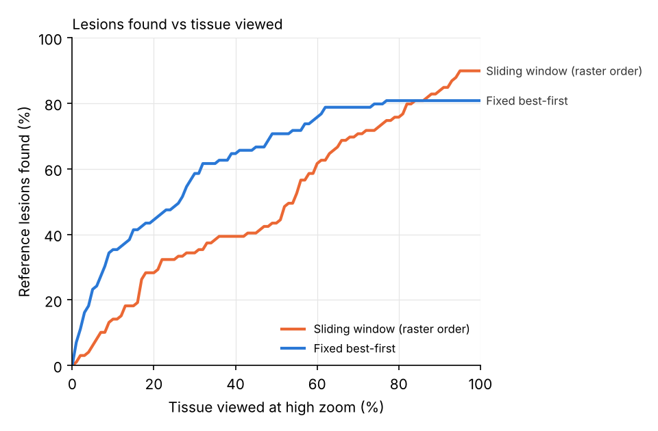

# AI Pathologist Agent: technical report (draft)

> Draft. Numbers marked **[TBD]** are filled in from `eval/results/<tag>/summary.md` once the PCam model is trained.
> Current numbers come from the CPU stand-in classifier and are labelled as such.

## 1. Problem

When breast cancer is diagnosed, the sentinel lymph nodes are checked for metastases. Each glass slide becomes a
gigapixel image (CAMELYON16 slides are about 100,000 x 220,000 pixels at 0.24 µm/px). Small metastases are easy to
miss and reading slides takes a lot of pathologist time. Exhaustive tile classifiers work, but they read every tile
and hand back a heatmap with no reasoning.

We built an agent that reads a slide the way a pathologist does: survey at low zoom, zoom only where needed, follow
tumour to its edges, decide when there is enough evidence, and show every step. It is a research prototype and a
second reader, not a diagnostic device.

## 2. System

```
Claude (Amazon Bedrock)  ->  SearchSession (budget, rules, decision log)  ->  VisionService (OpenCV 5)  ->  S3 (CAMELYON16)
```

**Slide access.** Slides stay in the public `camelyon-dataset` bucket (us-west-2). We read the pyramid TIFF's tile
index and only the 512 px JPEG tiles a region needs, using HTTP range requests (tifffile + zarr + fsspec). A full
survey reads tens of megabytes of a 1.5 to 3.5 GB slide.

**OpenCV 5 does the image analysis.**

| Step | OpenCV 5 |
|---|---|
| Tissue detection | `cvtColor` to HSV, Otsu `threshold` on saturation, `morphologyEx` open/close, `findContours`, ink and border rejection |
| Low-zoom survey | 14 colour/texture features per 190 µm tile (`cvtColor` LAB/HSV, `Laplacian`, H&E optical density), quadratic logistic model |
| Quality | Laplacian variance blur score per look |
| Stain | Reinhard in LAB, Macenko with `cv2.eigen` on optical density |
| Inference | ONNX tile classifier through `cv.dnn` (`readNetFromONNX`, `blobFromImages`), batched |
| Lesions | `connectedComponentsWithStats`, `findContours`, `minAreaRect` for largest diameter in µm |
| Viewer and replay | Deep Zoom tiles cut and resized with `resize`, `imencode`; heatmaps with `applyColorMap` |

**Grid.** 96 px tiles at 0.97 µm/px (PCam's resolution). A cell is 8 x 8 tiles (~0.75 mm). One cell read at high
zoom is one *look*, the unit of budget. Regions are hotspots (connected cells with high survey scores) or sweep
blocks of the remaining tissue.

**Agent.** Claude gets six tools (`survey_slide`, `zoom_region`, `refine_region`, `measure_lesion`,
`flag_for_human`, `write_report`) plus a free `get_status`. Tool results include the snapshot of the most
suspicious look, so the model sees what the classifier saw.

**Safety in code, not in the prompt.** The look budget is hard. The slide-level call is computed from the evidence.
A negative report is refused until every hotspot has been viewed. Unrefined borderline cells, blurry looks and
lesions that run into unviewed tissue are flagged for human review automatically. If the LLM errors, refuses or
stalls, the session finishes with the fixed best-first search and says so.

**Baselines.** Fixed best-first (follow tumour edges up to 4 looks, then the highest survey score away from known
tumour) and an exhaustive sliding window, through the same tools and logging.

## 3. Models

**Tile classifier.** ResNet-18 pretrained on ImageNet, fine-tuned on PatchCamelyon (327,680 patches, 96 x 96 px)
with flips, 90° rotations and colour jitter, calibrated with temperature scaling on the PCam validation split, and
exported to ONNX (opset 17). `cv.dnn` output matches PyTorch to 1e-6. **[TBD: PCam test accuracy, AUC, ECE]**

Stand-in used during development: a 6-layer CNN trained on CPU on 11.6k tiles cut from 24 CAMELYON16 training slides
plus 4k hard negatives from tissue edges; tile test AUC 0.94 on held-out slides.

**Survey model.** Quadratic logistic regression on the OpenCV features, fitted on 17 training slides. Held-out tile
AUC 0.976 (tumor_026), 0.967 (tumor_003), 0.998 (tumor_013).

## 4. Evaluation

Fixed subset of 40 CAMELYON16 test slides (10 macro, 10 micro, 20 normal; `eval/test_subset.txt`, seed 16), scored
against the official reference masks. Each slide is scanned exhaustively once and cached, so every strategy and budget
replays on identical classifier outputs.

* **Efficiency curve:** reference lesions found vs share of tissue viewed at high zoom. **[TBD figure]**
* **Slide level:** AUC tumour vs normal. **[TBD for PCam model; stand-in below]**
* **Lesion level:** recall split into macro (> 2 mm) and micro (≤ 2 mm). **[TBD]**
* **Agent ablation:** LLM agent vs fixed best-first vs sliding window at equal budgets. **[TBD]**
* **Systems:** seconds and dollars per slide on Graviton (c7g) vs x86 (c7i). **[TBD]**

**Stand-in results** (CPU stand-in classifier, `eval/results/standin/`; replaced once the PCam model is trained).
Lesion recall counts macro + micro metastases (99 lesions); isolated tumour cells (ITC, < 0.2 mm) are reported separately.

| Strategy | Looks | Tissue viewed | Slide AUC | Macro found | Micro found | ITC found | False-positive tiles / slide |
|---|---|---|---|---|---|---|---|
| Best-first | 10 | 7% | 0.70 | 13/21 | 9/78 | 18/162 | 63 |
| Best-first | 20 | 14% | 0.73 | 18/21 | 18/78 | 32/162 | 131 |
| Best-first | 40 | 29% | 0.70 | 20/21 | 25/78 | 45/162 | 256 |
| Best-first | 80 | 54% | 0.71 | 21/21 | 40/78 | 56/162 | 453 |
| Best-first | 160 | 82% | 0.73 | 21/21 | 59/78 | 78/162 | 659 |
| Sliding window | all | 100% | 0.73 | 21/21 | 68/78 | 90/162 | 798 |



Best-first finds about 58% of lesions after viewing 29% of the tissue, where a raster scan has found about 35%. It
finds 20 of 21 macrometastases with 29% of the tissue and raises a third of the false-positive tiles. Slide AUC is
low (0.70 to 0.73) for every strategy because the stand-in classifier fires on normal tissue on several slides (see
section 5). That is a model limit, not a search limit, and is expected to improve with the PCam model.

**A search fix found through the gallery.** On test_114 the survey scores saturated (99 of 417 tissue cells at 1.00),
so ties were broken arbitrarily and best-first stayed in one corner, missing two 8 mm metastases at 40 looks. Breaking
near-ties by distance from already-viewed tissue fixed it (3/3 at 40 looks) and raised macro recall at 40 looks from
18/21 to 20/21; micro recall moved from 28/78 to 25/78, so overall lesion recall is unchanged (0.465 vs 0.455).

## 5. Failure cases

`scripts/failure_gallery.py` renders the largest missed lesions and strongest false alarms with the reference outline.
Each case is labelled a *search failure* (the classifier fires on it, but the search never looked there) or a *model
failure* (the classifier does not fire, or fires on normal tissue). Stand-in, best-first at 40 looks
(`eval/results/standin/gallery/`):

* Search failures: test_040 (2.1 mm, the one missed macrometastasis), test_075 (1.5 mm and 0.9 mm), test_001 (1.4 mm).
  The search spent its budget elsewhere before reaching them.
* Model failure, missed: test_082 (1.8 mm), which the classifier does not fire on even when viewed.
* Model failure, false alarms on normal slides: test_044 (909 tiles), test_098 (426), test_055 (209), test_034 (208),
  test_037 (133). Sinus histiocytes, pink paracortex and vessel walls are mistaken for tumour.

**[TBD: gallery from the final model]**

## 6. Limits and responsible use

Research prototype and second reader; a pathologist signs off on every slide. Trained and tested only on CAMELYON16
(two Dutch hospitals, H&E, breast cancer lymph nodes); performance on other scanners, stains or cancers is unknown.
Small metastases remain the weak spot. Data is public, de-identified and CC0.

## 7. Reproduce

See `README.md`. `scripts/build_cache.py` then `scripts/eval_suite.py` regenerates every table and figure.

Data: CAMELYON16 (Ehteshami Bejnordi et al., JAMA 2017), PatchCamelyon (Veeling et al., MICCAI 2018), both CC0.
