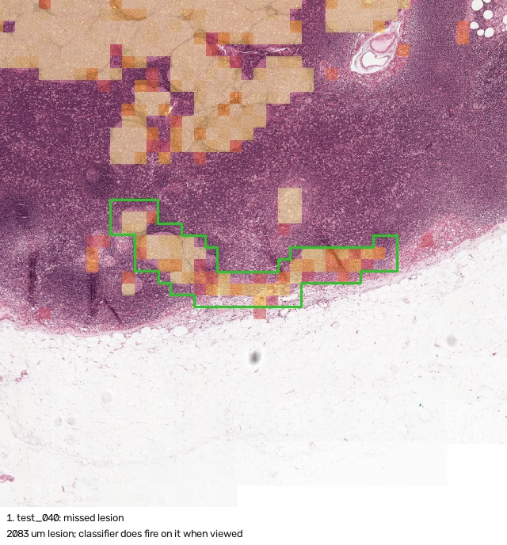
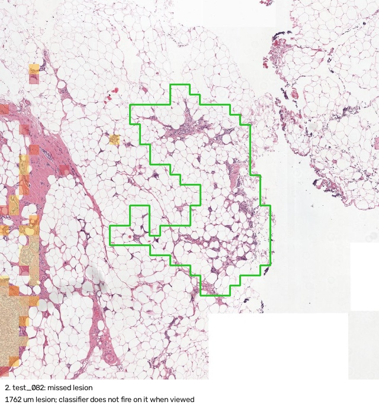
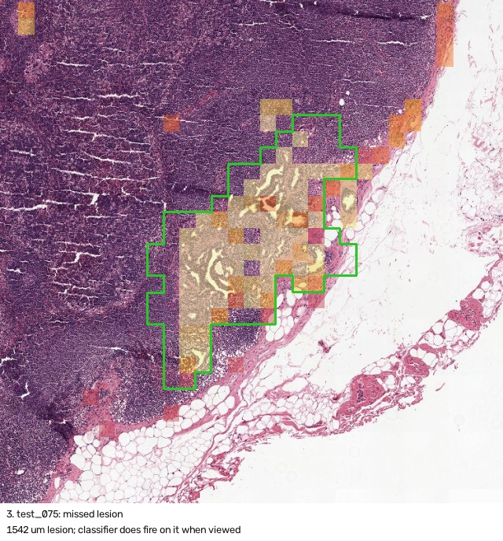
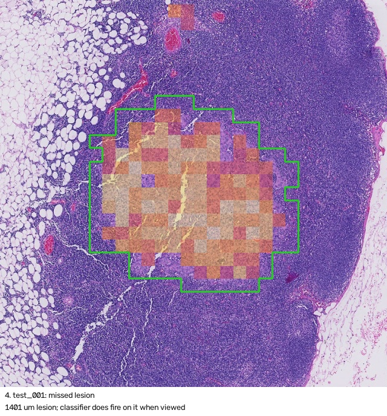
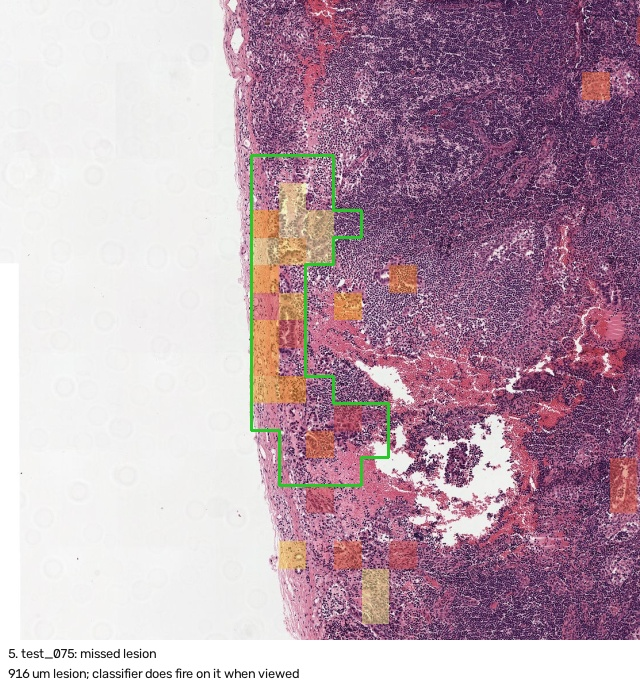
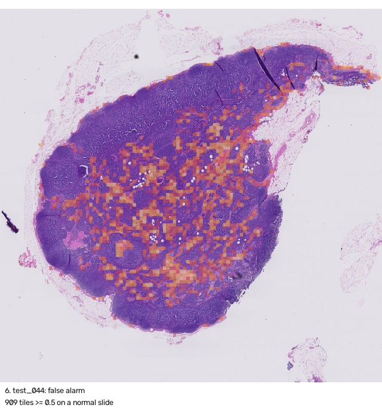
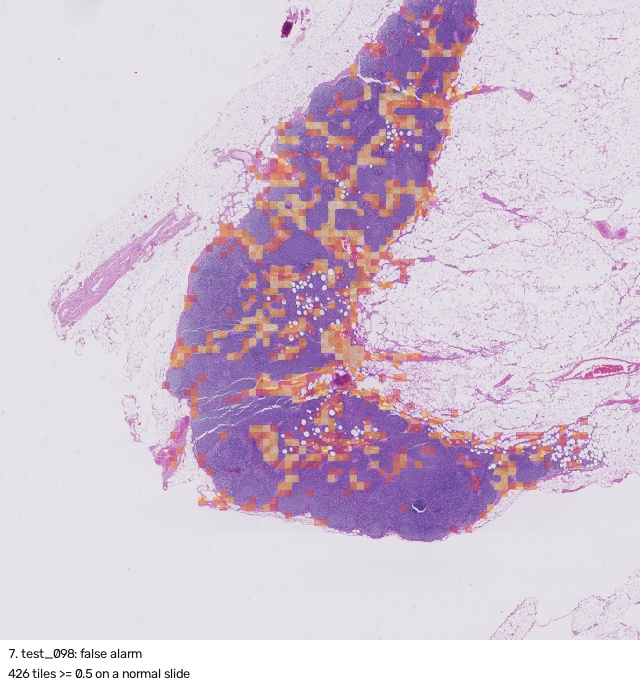
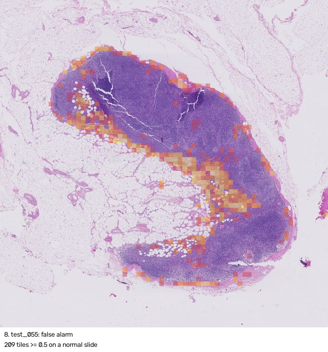
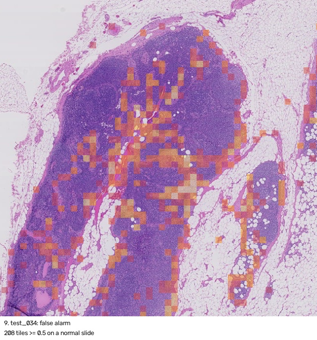
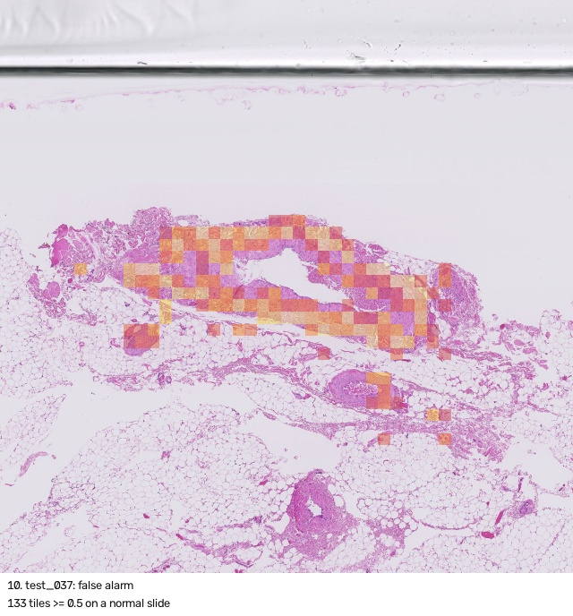

# Failure gallery (standin, best_first, budget 40)

Green outline: reference tumour. Tinted tiles: classifier probability >= 0.5 (exhaustive scan).

## 1. test_040: missed lesion

2083 um lesion; classifier does fire on it when viewed. Likely cause: search failure: the classifier sees it, the search never looked there.

## 2. test_082: missed lesion

1762 um lesion; classifier does not fire on it when viewed. Likely cause: model failure: the classifier does not fire on it.

## 3. test_075: missed lesion

1542 um lesion; classifier does fire on it when viewed. Likely cause: search failure: the classifier sees it, the search never looked there.

## 4. test_001: missed lesion

1401 um lesion; classifier does fire on it when viewed. Likely cause: search failure: the classifier sees it, the search never looked there.

## 5. test_075: missed lesion

916 um lesion; classifier does fire on it when viewed. Likely cause: search failure: the classifier sees it, the search never looked there.

## 6. test_044: false alarm

909 tiles >= 0.5 on a normal slide. Likely cause: model failure: tissue mistaken for tumour.

## 7. test_098: false alarm

426 tiles >= 0.5 on a normal slide. Likely cause: model failure: tissue mistaken for tumour.

## 8. test_055: false alarm

209 tiles >= 0.5 on a normal slide. Likely cause: model failure: tissue mistaken for tumour.

## 9. test_034: false alarm

208 tiles >= 0.5 on a normal slide. Likely cause: model failure: tissue mistaken for tumour.

## 10. test_037: false alarm

133 tiles >= 0.5 on a normal slide. Likely cause: model failure: tissue mistaken for tumour.

